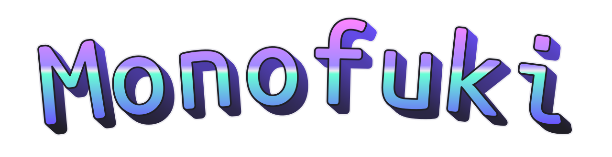

# 

Monofuki is my fork of Monofoki. I’ve fucked with it to fix the missing characters and terminal annoyances that bother me. If it works for you too, great.

Upstream: [Monofoki by Marvin Dostal (datMaffin)](https://github.com/datMaffin/monofoki), based on [Mononoki by Matthias Tellen](https://github.com/madmalik/mononoki). This fork is by [Greg Mason (nodoubleg)](https://github.com/nodoubleg).

I mainly use iTerm2 on macOS. My priorities are symbols, Braille artwork,
and repeatable regular and Nerd Font builds. Your setup and taste may differ.

Try the [specimen](https://nodoubleg.github.io/monofuki/),
[playground](https://nodoubleg.github.io/monofuki/playground.html), or
[customizer](https://nodoubleg.github.io/monofuki/customize.html). Download
[Monofuki](https://nodoubleg.github.io/monofuki/downloads/Monofuki.zip) or
[Monofuki Nerd Font](https://nodoubleg.github.io/monofuki/downloads/MonofukiNerdFont.zip).
The [PDF specimen](script_helper/specimen.pdf) is an inherited Monofoki specimen;
`script_helper/specimen.tex` now targets Monofuki for future regeneration.

The [upstream copyright notices, Reserved Font Names and SIL Open Font License](LICENSE)
remain intact. This fork’s family name is Monofuki. Imported symbols and icons
keep their own terms and attribution; not every icon is OFL-licensed. See
[symbol provenance](licenses/NOTICES-symbols.md) and
[component licensing notes](licenses/license-audit-nerd-font.md).

## Source and build layout

`src/overlays.json` describes this fork’s changes. It contains no copied
upstream or donor outlines. Four upstream SFDs are fetched at the exact commit
and SHA-256 values in `script_helper/build_dependencies.json`. The assembler
writes disposable merged sources to `.font-build/assembled/`, adding generated
Braille, the 415 pinned donor symbols, and three same-weight upstream arrows
in each italic style. Bold and Bold Italic use their own upstream sources.

The assembler checks inherited glyph records byte for byte, along with references,
metadata and line metrics. It allows the family rename, glyph count updates and
fingerprinted authored overrides; there are no authored replacements yet.
`glyph-provenance.json` records every source glyph’s mapping, dependencies and
provider. Unreviewed upstream/overlay collisions stop the build. See
[glyph ownership and overrides](docs/glyph-overrides.md) for edits and
[upstream review](docs/glyph-overrides.md#upstream-updates) for updates.

Export cleanup rounds and unlinks outlines, so source preservation does not imply
binary identity. Nerd patching substitutes the heart and seven Powerline glyphs,
regenerates Braille and normalizes OS/2 typographic metrics. These allowances are
in `src/nerd-policy.json`; other outlines and advances are checked against the
regular font passed to the patcher.

Install FontForge, Python 3 with fontTools, `woff2_compress`, and curl.
`--hint` additionally needs `ttfautohint`. `nix-shell` supplies these tools;
CI installs them on Ubuntu. Input bytes are pinned, but toolchains and host
rendering are not claimed to be bit-for-bit reproducible. Exports include the
input lock, source and symbol provenance, and component notices.

See [CONTRIBUTING.md](CONTRIBUTING.md) for the clean upstream branch workflow.

## Automated builds

The [Build fonts workflow](https://github.com/nodoubleg/monofuki/actions/workflows/build-fonts.yml)
runs on pushes to `master`, `v*` tags, pull requests, and manual runs from the
Actions tab. It uses an Ubuntu 24.04 GitHub runner to build all four styles
with `./create_font.sh --hint`, then applies checksum-pinned Nerd Fonts 3.5.1 patching.
The shared tuning compiler then applies my current settings to all four regular
and Nerd styles, preserving the complete character sets. Source checks, all 32
alternative profiles, spacing regressions and exported-font checks run before
upload. See the [customizer build notes](website/README.md#customizer-and-playground)
to reproduce the tuned downloads locally.

Download `Monofuki-<commit>-attempt-<n>` or
`MonofukiNerdFont-<commit>-attempt-<n>` from the run's
Artifacts section. The regular bundle contains TTF, hinted TTF, OTF, WOFF2
from OTF, hinted WOFF2 from TTF, and the font license. The Nerd Font bundle
contains patched TTF, OTF, WOFF2 from OTF, and licenses. Changed outlines in
Nerd TTFs and browser-built TTFs are unhinted; regular native exports also provide
separate autohinted files.
Artifacts are retained for 30 days. Generated fonts are uploaded as artifacts
and are not committed to the repository.

After the Linux build succeeds, I verify its exact artifacts on my connected Mac.
The owner-submitted native evidence then unlocks a separate Ubuntu workflow that
builds the [GitHub Pages specimen](https://nodoubleg.github.io/monofuki/), records
the terminal demo, and publishes from `master`. The Mac is not a self-hosted runner.
Until that supervised step passes, the existing site stays live and unchanged.
See [the native verification handoff](docs/native-verification.md) for commands,
provenance, and retry behavior. Print all of the site's artwork with
`python3 script_helper/terminal_demo.py --art`.

## Terminal graphics

All four styles include the 256 Unicode Braille patterns (`U+2800–U+28FF`).
These are often used for dotted terminal artwork. The glyphs match Nerd Fonts
3.5.1's default rectangle geometry: upright 172.5 by 184.5-unit dots on a
two-column, four-row grid. The base grid fills a 575 × 1230-unit cell. The tuned downloads map it vertically
to the selected 575 × 1150-unit cell, keeping dot spacing continuous across
character and line boundaries. Braille stays upright and is not emboldened in
the bold styles.

To try the font, build with `./create_font.sh`, install the resulting fonts
from `export/`, select Monofuki in your terminal, and run:

```sh
python3 script_helper/terminal_demo.py
python3 script_helper/terminal_demo.py --all  # also show every Braille pattern
```

The demo includes artwork, a repeated dot grid, box and block joins, arrows,
and ANSI bold/italic samples when output goes to a terminal. `--plain` omits
ANSI styling; `--width 32` makes the artwork smaller. It uses your terminal's
active font; it does not install or select a font. Extra terminal line spacing
can still introduce gaps, and some terminals draw graphics themselves.
For Nerd Font builds, run `./post_create_nerdfonts.sh` after building; it needs
FontForge, Python 3 with fontTools, and curl. It downloads and verifies the pinned 3.5.1
patcher rather than using a different version on `PATH`. It prefers a hinted
TTF only when that file is
newer than the unhinted TTF. To refresh hinted files too, install `ttfautohint`
and build with `./create_font.sh --hint`.

To update an existing macOS installation after rebuilding:

```sh
./update_installed_fonts.sh --dry-run  # preview matching replacements
./update_installed_fonts.sh           # back up, replace, and verify
```

This updates already-installed Monofuki and Monofuki Nerd Font styles in
`~/Library/Fonts` to the rebuilt OTF versions. It backs up the existing files,
installs and verifies the OTFs, then removes superseded TTFs (including hinted
TTFs) to avoid duplicate formats. It skips unchanged OTFs and does not install
additional styles. Backups go to a timestamped folder under
`~/Library/Application Support/Monofuki/font-backups/`. Quit and reopen apps
using the fonts afterward. Fonts installed system-wide or under renamed files
are not updated by this helper; use Font Book for those. To restore a backup,
remove the replacement OTFs for the backed-up styles, copy the backup files
back to `~/Library/Fonts`, and restart the affected apps.

Source assembly and validation:

```sh
fontforge -lang=py -script script_helper/assemble_sources.py
fontforge -lang=py -script script_helper/assemble_sources.py --check
fontforge -lang=py -script script_helper/test_source_preservation.py
fontforge -lang=py -script script_helper/test_upstream_conflicts.py
python3 script_helper/check_unicode_data.py
fontforge -lang=py -script script_helper/check_terminal_glyphs.py
fontforge -lang=py -script script_helper/check_terminal_glyphs.py export/Monofuki-Regular.ttf
fontforge -lang=py -script script_helper/audit_font_coverage.py
```

The outline check verifies all 256 encodings against Unicode dot names,
including the blank pattern, grid positions, contour direction, cell width,
unchanged line metrics, and coverage of ASCII, boxes, blocks and restored
arrows. It allows half a font unit of export rounding. The coverage audit
accepts font paths; with multiple explicit paths it also reports characters
present in the final font but absent in the first.

### Earlier coverage comparison (October 2026)

The four assembled sources have identical encoded character coverage. Three arrows
(`⇨` U+21E8, `⇩` U+21E9, `⇯` U+21EF) were restored in Italic and Bold-Italic
from the pinned Monofoki upright sources at the corresponding weight.

The comparison below records the earlier Monofoki audit, before the 415 donor symbols
were added. It is retained as history, not the current coverage table. The
current sources have 3/64 Control Pictures and 250/256 Legacy Computing slots;
the other Monofuki counts in this table are unchanged. Run the coverage audit
above for the current counts.

| Unicode range | Monofuki, all styles | FiraMono Nerd Font Mono Regular 3.4.0 |
| --- | ---: | ---: |
| Printable ASCII | 95/95 | 95/95 |
| Box Drawing | 128/128 | 128/128 |
| Block Elements | 32/32 | 32/32 |
| Braille Patterns | 256/256 | 256/256 |
| Geometric Shapes | 38/96 | 55/96 |
| Arrows | 29/112 | 15/112 |
| Miscellaneous Technical | 7/256 | 13/256 |
| Control Pictures | 0/64 | 0/64 |
| Symbols for Legacy Computing (`U+1FB00–U+1FBFF`) | 0/256 | 0/256 |

Counts are code-point slots in each range, not counts of assigned Unicode
characters. The comparison uses unpatched Monofuki sources and the installed
FiraMono Nerd Font Mono reference; private-use Nerd Font icons are excluded.
FiraMono was not a superset of Monofuki. That audit also recorded these
differences:

* FiraMono has 38 shapes absent from Monofuki: `U+25AA–25AF`, `25C6–25C7`,
  `25C9–25CA`, `25CE`, `25D9–25E5`, `25E7–25EB`, `25EF–25F7`.
* Other reference-only symbols include `⇪` (`U+21EA`), `⌂` (`U+2302`),
  `⌐` (`U+2310`), `U+2320–2321`, `U+2327–2328`, and power symbols
  `U+23FB–23FE`. Nerd Font patching can supply some of these separately.
* At that point, both fonts lacked the Control Pictures and Legacy Computing
  ranges above.
  Other language and symbol ranges are also incomplete; this is a terminal
  graphics audit, not a promise of universal Unicode coverage.

### Unicode symbols on macOS

The terminal-symbol target is the 2,113 assigned printable characters in the
14 ranges listed by `perl script_helper/unicode_specimen.pl --list`, using
Unicode 18.0.0. This update adds 415 symbols that were missing with macOS
system fallback, including ribbon arrows, astrological symbols, and legacy
computing graphics. It preserves existing glyphs and uses matching Unicode
outlines from Nerd Fonts 3.5.1's Iosevka build first, then Noto Sans Symbols 2
and Kreative Square. Sources, transformations and licenses are recorded in
`script_helper/symbol_additions.json` and `licenses/NOTICES-symbols.md`.

The target is Terminal.app and iTerm2 on macOS, with Monofuki selected and no
separate non-ASCII font override. Built-in macOS fonts supply symbols already
covered by system fallback. This is not a claim of all-Unicode coverage.
The macOS release check is:

```sh
swift script_helper/check_macos_symbols.swift export/MonofukiNerdFont-*.otf
perl script_helper/unicode_specimen.pl --font export/MonofukiNerdFont-Regular.otf
```

The Perl specimen uses bundled Unicode 18.0.0 assignment, name and width data,
even when the installed Perl has an older Unicode database. Its default
`--presentation emoji` adds FE0F only to standardized non-ASCII emoji bases;
macOS supplies the color glyphs from Apple Color Emoji. `--presentation text`
requests FE0E; `--presentation native` leaves the characters untouched. Actual
application output chooses its own selectors, so the font cannot force every
emoji-capable character into the same presentation. `!` checks the font file's
base-character map; a character marked absent can still render via fallback.

### Emoji presentation checks

None of the 415 donor additions is Emoji=Yes in the pinned Unicode 18 data.
The current regular font contains two inherited default-emoji squares
(`U+25FD`, `U+25FE`); Nerd patching also supplies `U+26A1` lightning. Plain text
can use their monochrome glyphs. VS16 requests emoji; VS15 requests text where
Unicode defines that variation. Unsupported selector combinations are only
diagnostic probes, not promises of text or emoji support.

```sh
python3 script_helper/audit_emoji.py export/Monofuki-*.otf export/MonofukiNerdFont-*.otf
swift script_helper/check_macos_emoji.swift .font-build/emoji-cases.json \
  export/Monofuki-*.otf export/MonofukiNerdFont-*.otf \
  --preview-dir .font-build/emoji-previews > .font-build/emoji-coretext.json
python3 script_helper/check_emoji_results.py .font-build/emoji-coretext.json
```

The macOS check shapes whole strings, records each resolved font and UTF-16
range, and compares supported emoji clusters with a same-host Menlo baseline.
It includes plain/VS15/VS16 symbols, keycaps, a skin-tone modifier, a flag, and
ZWJ sequences. Local macOS 27.0.1 tests covered all eight styles: supported
emoji probes used Apple Color Emoji, without missing glyphs or split clusters.
This is CoreText evidence, not a Terminal.app/iTerm2 rendering guarantee. No
font is installed and no global Apple font or terminal setting is changed.
CI retains its native JSON and PNG evidence with the CoreText artifact.

## Upstream design history

These goals, experiments and TODOs are from datMaffin/monofoki’s README.
“I” refers to Marvin. They describe his work, not my current roadmap.

### Marvin’s original goals

The goal of this fork is to change the Mononoki font to use my preferences.
This means that various glyphs and their dependencies were modified and that the bold style no longer has a larger height than the regular style.

This version also tries to fix all the known issues and at times adds additional glyphs.

**Disclaimer: I am *not* a professional in the field of type-design!**

### Original design changes

- [x] Make the "m" similar to Ubuntu Mono "m"
- [x] Decrease width of "n" similar to Ubuntu Mono
  + Change glyphs dependent on "n" correspondingly: "h", "r", "u", "k"
- [x] Increase width of "o" similar to Ubuntu Mono
  + Change glyphs dependent on "o" correspondingly: "O", "e", "U", "Q"
  + [x] Also need to check size relation to "C", "c" and "G".
        Looks ok... "O" is a little bit wider than "C" and "G". "C" and "G"
        have the same width. May increase width of "C" and "G" a little bit.
- [x] Increase width of "s" similar to Ubuntu Mono
  + Study the relation of width from "s" to "S" in other Fonts.
    Fonts vary in  their relation. Decided on mononoki "s" looks perfectly
    fine.
- [x] Use "l" glyph for the "i" as well
- [x] Increase height of middle line in "a" to line up with "e"
  - [x] May need further refinement
- [x] Italic "J" and BoldItalic "J" have different shapes
- [x] Decrease width of "w" to be more similar in width with "m"
  - [x] May need further refinement
- [x] Fix missing UTF-8 glyphs: ä, ö, ü
  + This problem happens when creating a file with the macOS finder
    conaining ä, ö, ü: When using iTerm the file name is not printed in the
    Mononoki-Font.
  + The **fix** was: Add zero width glyph COMBINING DIARESIS (Nr. 776) with
    diaresis in negative space.
  + Setting all the combining characters to "mark" and having them in the regular (positive) space also seemed to work
- [x] Reduce bold italic "r" stem width to equal all other letters stem widths
- [x] TTF autohinted bold italic "o" is too high (turned out to be an exclusive
      Java/Intellij Idea issue; probably not related to TTF autohinted)
- [x] CANCELED: Put "E" and "F" middle stroke ontu the same height

### Original experiments and ideas

* Lower the bar of "f" similar to Consolas
* Create a build pipeline (with the source being FontForge .sfd files)
  - Use ttfautohint
* Bold currently increases the height of glyphs a little to much for my taste.
  - Bold is now auto generated: Generate the bold sfd's from the regular sfd's with the [upstream generation script](https://github.com/datMaffin/monofoki/blob/dc8a1890040de522231da8aec6d4d95bc672cf1e/script_helper/generate_bold_sfd.sh).

### Original fork-specific problems

* FontForge does not have a tool to create rounded edges

### Original TODOs

- [x] Fix directions of glyphs in FontForge
- [x] .ttf fonts wont work on macOS (otf is working)
- [x] macOS is still complaining about the name table
- [x] FontForge tutorial says to change layers to quadratic before exporting
      font as ttfs
- [x] Issues with back- and frontticks: for some reason they get wrongly
      rendered on top of the letter infront.
      Adding all combining accents (from UTF 0x300 onward) did not resolve
      this issue.
      Solution (Fix) was:
      For all affected glyphs set "OT Glyph Class" to "Base Glyph"
